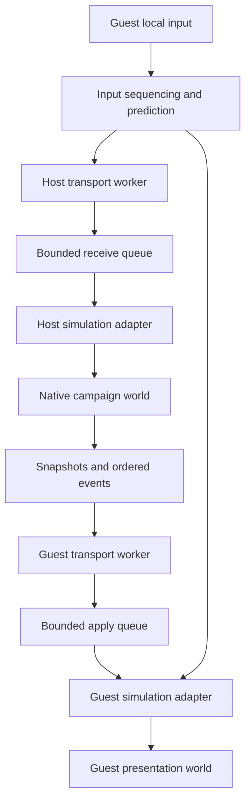
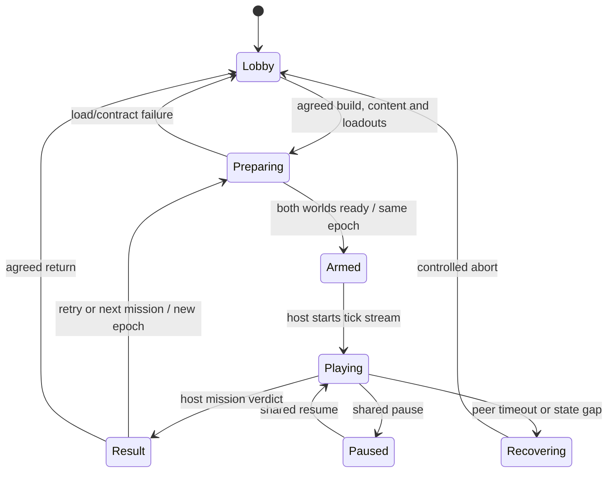

# Implementation specification: two-player online campaign co-op

**Status:** implementable work breakdown with explicit discovery/runtime gates;
not a claim that a working patch or all callable game contracts already exist.
Target is the exact executable identified in the [research dossier](../reverse-engineering/coop/README.md).
All behavior in this document is **D: proposed patch design** unless linked to
an S/H finding. The project continues on branch `mp`.

## 1. Product contract and initial decisions

Two independently rendered Windows game instances share one authoritative
campaign mission. The host owns mission progression and campaign persistence;
each person owns one pilot's input and local view. Both can fly, target, fire,
take damage, destroy targets and reach the campaign's result/next-mission flow.
Existing script-owned wingmen/bosses retain their story roles.

| Decision | Baseline policy |
| --- | --- |
| Player count | Exactly two human slots; peer cannot choose/control the other's slot |
| Simulation authority | Host owns world, AI, weapons, damage, objectives and results |
| Guest response | Local flight prediction only after integrator dependencies are validated; authoritative correction |
| Session entry | Lobby / between missions; no join-in-progress in the first release |
| Save ownership | Host campaign save; guest is a helper and does not write campaign progress by default |
| Progression | Host selects mission/difficulty/loadouts; both acknowledge the same content/epoch |
| Camera | Full-size local view follows the local human; no forced split-screen on either instance |
| Pause | Host-authorized shared pause; network heartbeat remains active |
| Death | One human down: spectator; both down: mission failure; script-critical exceptions are resolved explicitly |
| Retry | Both peers discard old world work and enter a new mission epoch |
| Disconnect | Freeze/abort the co-op mission to lobby after timeout; no invisible AI takeover or host migration in v1 |
| Distribution | Separate co-op runtime/loader and metadata; existing SceneClean bridge remains independently usable |

The first engineering target is **two humans in an ordinary campaign mission
inside one local process**. This proves the game-side premise before networking.
The static code supports two-lane input and count-based contexts, but the stock
world binding assumes player i uses the first actor of group i. Campaign data
must supply the correct friendly actor; a count-only patch fails this contract.

## 2. Architecture

Network workers parse/validate/enqueue. Only the tracked simulation thread may
resolve native objects or call native functions. Render callbacks consume
immutable telemetry. Never invoke a native damage/spawn/mode function from an
IO completion callback, `DllMain`, a ReShade draw callback or a detached worker.

Proposed module layout:

| Module | Responsibility | Dependencies |
| --- | --- | --- |
| `coop-core` | Session/epoch/tick, IDs, protocol, event ordering, authority, bounded queues | Platform-neutral; testable without game |
| `coop-transport` | Direct-IP transport for first network tests; transport adapter for later Internet matchmaking/relay | Authentication, loss/reorder handling, monotonic time |
| `coop-runtime` | Hash-gated Windows x64 loader, hook lifecycle and diagnostics | RE01–RE03; loader outside loader-lock work |
| `coop-game` | Typed native adapters for player construction/input/entity/mission/result | RE04–RE17; no inferred ABI accepted silently |
| `coop-view` | Local pilot view, HUD, spectator and UI status | RE14 and render compatibility |
| `coop-trace` | Bounded event/state trace, replayable impairment runs and diagnostics | Read-only by default |

Implementation language can remain Rust for the core/runtime to fit the existing
repository, with small C++/assembly adapters where ABI recovery requires them.
Do not enlarge the old XInput calibration proxy into the co-op runtime: it
currently forwards only two exports and the repository already records input
interference. Reuse the existing host-SHA validation pattern, not its renderer
hook set as a simulation API.

## 3. Native adapter contracts

Candidates are machine-readable in [HOOK_CANDIDATES.json](HOOK_CANDIDATES.json).
They include expected file bytes and are all marked **not runtime approved**.
Instruction-safe detours need a proper trampoline/relocator after RE validation;
a 32-byte fingerprint is not an overwrite-length instruction.

| Adapter | Starting seams | Must prove before enabling |
| --- | --- | --- |
| `WorldLifecycle` | `16E0B0/16E4C0`, `16E880`, VS wrappers | Thread, readiness, epoch capture, nested-hook deduplication, arena lifetime |
| `InputAdapter` | Post `188A80`, pre `188180`; `187390`, `201DC0` | Device selection, raw neutral/range, logical slot, exactly-once edge generation |
| `CampaignPlayerFactory` | `16EB20`, `0C6A50`, `135B50`, `135CB0`, `12C520`, `0CBCC0` | Both loadouts/resources, definition expansion, constructor order and correct friendly actor binding |
| `FlightAdapter` | `1040C0`, `10EAD0`, player/actor state | Integrator state, write phase, units, all pose mirrors and local view separation |
| `EntityAdapter` | `1363C0`, specialized group vtables, lifecycle paths | Native spawn/despawn/reuse, generation and resource ownership |
| `WeaponAdapter` | Target/weapon paths and controller vtables | Source/target IDs, actual launch/hit/expiry, ammo and every supported special weapon |
| `DamageAdapter` | `118040/117A10/115C20` | Recursive effects, HP/score attribution, host-only decision and client outcome application |
| `MissionAdapter` | `12BF60`, `0D1780`, VM/state fields | Objective/script/timer/cutscene events and side effects, transition barriers |
| `ResultAdapter` | `16E4C0`, GameEnd and return constructors | Single agreed result, host save/unlocks, guest disk-write suppression |
| `ViewAdapter` | Player cameras and `0D2580` | Guest follows slot 1 without changing authoritative actor/AI/RNG ordering |

Every adapter has `observe`, `validate`, `enable` and `disable` states. An
unvalidated adapter reports unsupported instead of proceeding with a guessed
pointer or signature. On a build mismatch, no game-memory writes/hooks activate.
The original game behavior remains the baseline until the co-op session is
explicitly armed.

## 4. Campaign P2 construction algorithm

1. Load ordinary campaign definitions and player loadout resources normally.
2. Before `SizeInitialGroupArena`, build an owned, lifetime-safe expanded
   definition set that adds the guest's friendly unit/actor without renumbering
   script-referenced groups. Prefer appending plus an explicit player→actor map;
   if native code hard-codes group i for player i, adapt those bindings at the
   recovered seams and audit all consumers.
3. Prepare valid P1/P2 arrays for the ten-position `0C6A50` contract. The unused
   argument position is still accounted for in the ABI; no caller stack garbage
   is relied upon.
4. Allocate two player contexts and the native companion arrays. Construct the
   definition-driven group storage through native initializers, then perform
   world/resource wiring.
5. Override/validate player binding in all native consumers: actor `+1B8`, player
   group/actor selectors, targeting, radar, collision, damage and presentation.
6. Assign the guest a campaign-friendly category and preserve all story actors.
   Validate the observed relation table and every other category consumer before
   changing its data. Do not globally rewrite unrelated single-player rules.
7. Keep scene rendering local: host follows P1, guest follows P2. Do not force VS
   mission identifiers/options into campaign to obtain a second viewport.
8. Complete a local mission, retry it, exit to menu and reload. Arena/pointer
   lifetime must be clean before any remote session is attempted.

**Blocking fact:** mission assets/definitions were not supplied to this static
investigation. Definition layout and all script-index dependencies must be
recovered from the actual install during RE06. This algorithm is a work contract,
not a patchable sequence certified by the EXE alone.

## 5. Session and transition state machine

The network keepalive clock is monotonic wall time. Accepted simulation ticks
advance only with the validated simulation boundary. Each mission/retry increments
an epoch; all packets, entity mappings, event IDs and queued commands carry it.
Late packets from the old world are dropped before native lookup.

For mission/movie/result transitions, the host sends the intended transition
and content ID, waits for acknowledgement/readiness, then commits it once.
Local UI cannot independently advance the guest's mission or invoke a save path.
Loading timeout returns both peers to a recoverable lobby; it does not leave one
instance in combat while the other is on a result screen.

## 6. Protocol v0 proposal

This is a new schema. No layout below is claimed to exist in `acz.exe`.
Serialize explicitly in little-endian order; never cast a received buffer to a
native C++/Rust object.

Common application header (40 bytes):

| Field | Bytes | Meaning |
| --- | --- | --- |
| Magic | 4 | `ACZ2` |
| Protocol version | 2 | Reject incompatible protocol |
| Message type | 2 | Bounded known message enum |
| Session ID | 16 | Random session identifier, checked against the established authenticated peer |
| Mission epoch | 4 | World generation |
| Packet sequence | 4 | Per-channel transport/application sequence |
| Tick | 4 | Accepted host tick or intended input tick |
| Payload length | 2 | Exact validated byte count |
| Flags | 2 | Defined bits only |

| Message | Channel behavior | Contents |
| --- | --- | --- |
| `Hello/Accept/Ready` | Reliable/ordered | EXE hash, patch/protocol version, content manifest, role, mission, options and loadouts |
| `Input` | Sequenced, with bounded redundant recent samples | Input sequence, owned slot, flags, canonical controls |
| `WorldSnapshot` | Sequenced; baseline acknowledged | Tick, baseline ID, bounded chunks of explicit entity/mission state |
| `Spawn/Despawn` | Reliable/ordered | Patch entity ID, native definition identity and validated construction data |
| `WeaponEvent` | Reliable/ordered for accepted authoritative events | Source/target IDs, weapon class, accepted launch/hit/expiry and ammo outcome |
| `Damage/Kill/Score` | Reliable/idempotent | Event ID, source/target, final health and exact result/attribution |
| `MissionEvent/Transition/Result` | Reliable/ordered | Mission event sequence, epoch/barrier, host verdict and result digest |
| `Ack/Heartbeat/ResyncRequest` | Bounded control channel | Received event/baseline state, liveness and missing ranges |

Canonical controls are 12 bytes: four signed 16-bit axes, a 16-bit button mask,
and two 8-bit trigger magnitudes. The input payload adds a 32-bit input sequence,
one slot byte and one flags byte: **18 bytes**, before optional redundant samples.
The adapter reproduces the game's calibrated conversion. Button edges derive
from accepted successive held samples, not from repeated network packets.

Entity IDs are `(epoch:uint32, spawn_serial:uint32)`. Maintain a local mapping to
native group/actor slots and generation. The native selector pair or actor
`+0x228` alone is insufficient until reuse behavior is proven. No packet carries
a process pointer, vtable, callable RVA or arbitrary write request.

Transport first proves two-process delivery using an authenticated direct-IP
path. Internet NAT traversal/matchmaking/relay is a separate transport milestone;
evaluate a supported Steam networking integration or a maintained transport
library with its real account/relay requirements. The presence of SDK version
strings is not authorization or proof of a working game transport.

## 7. Replication and prediction

Host tick order:

1. Drain bounded validated input; enforce the assigned slot and input window.
2. Choose one held input sample per pilot for the accepted native tick.
3. Run the native input conversion and host simulation once.
4. Collect authoritative spawn/weapon/damage/mission/result events at their
   validated seams, assigning monotonic event IDs.
5. Emit a coherent snapshot after gameplay writes have completed.

Guest order:

1. Record/send its own input and optionally predict only validated local flight.
2. Drain authoritative events in dependency order: spawn before reference,
   damage before death result, transition before new-epoch entities.
3. Reconcile the local pilot; interpolate remote actors from complete baselines.
4. Run validated presentation work without independently committing AI damage,
   mission objectives, score or campaign save.

Do not both re-run native damage recursively and apply the host's resolved
cascade on the guest. An authority-application scope must prevent double damage,
score, FX and event re-export. Preserve the native original call on the host.

Initial rate targets: input 60 Hz and snapshots 20 Hz, **subject to measured
native tick behavior**. Interpolation starts at 100 ms and is tuned from jitter
traces. Do not change the game's physics timestep just to match these rates.

Illustrative bandwidth budget: a proposed 52-byte pose record (ID 8, position
12, orientation quaternion 16, velocity 12, flags 4) × 200 entities × 20 Hz is
208,000 bytes/s, about 1.66 Mbit/s of pose payload before headers/events. This is
an engineering example, not a measured game entity count or recovered format.
Convert the native orientation only after RE08 proves its representation.

Use an application datagram budget of 1,200 bytes initially. Twenty such pose
records plus a 16-byte snapshot prefix and the common header total 1,096 bytes.
Larger snapshots need bounded chunking, a shared snapshot ID and a complete-chunk
apply rule. Missing baselines trigger a reliable keyframe; a delta without its
baseline is never applied as absolute state.

The recovered [playback/weapon paths](../reverse-engineering/coop/PLAYBACK_AND_WEAPONS.md)
can inform guest presentation and event taxonomy. They retain native resource
pointers, consume random state in a scatter launch path, and prepare synthetic
playback state. Do not use their raw records as wire packets or enter playback
mode as a replacement for a validated guest authority adapter.

## 8. Mission and gameplay policy coverage

| Area | Required behavior / acceptance case |
| --- | --- |
| Flight and collision | Independent controls, terrain/water collisions, stalls/limits if present, corrections without divergent mirrors |
| Targeting/radar | Both friendly human markers, correct target ownership, no self/friendly accidental lock or faction inversion |
| Weapons | Gun, ordinary missiles, multi-target and guided weapons, bombs/area effects, laser/ECM and all selectable special-weapon families |
| Damage | AI hits, friendly-fire policy, invulnerability/scripted kills, simultaneous kills, assists and score attribution |
| AI | Targets both humans appropriately; preserves escorts, wingmen, scripted leaders and boss logic |
| Mission script | Spawn waves, timed objectives, radio triggers, branching events, boss phases and story-sensitive actors |
| View/HUD/audio | Each peer's pilot view, camera cycling, targeting UI, sound listener and spectator mode |
| Supply/rearm | Consistent loadout/ammo/repair outcomes and synchronization across special supply modes |
| Pause and focus loss | Shared pause policy, no background tick drift; heartbeat survives pause |
| Death/failure | Team survival policy; original primary-pilot failure logic audited instead of blindly suppressed |
| Retry/checkpoint | New epoch, cleared events/IDs, identical reload selection, no stale pointers |
| Results/save | One host result, deterministic acknowledgement, one save/unlock transaction, guest remains non-owning |
| Campaign continuation | Every actual campaign route/content ID, final mission and return to the correct post-campaign state |

The script may make first-player assumptions. RE12 must enumerate them before
changing failure semantics. The guest should be an added pilot; taking over a
story wingman is not the default solution and would need a separate design.

## 9. Milestones and pass/fail gates

| Milestone | Concrete output | Pass condition | Blockers |
| --- | --- | --- | --- |
| M0 — read-only adapter | Trace DLL/loader and same-build manifest | Full lifecycle trace, correct thread/epoch, no writes or frame regression | RE01–03 |
| M1 — local campaign P2 | Native two-player campaign construction and input ownership | Both humans fly/fire/take damage; mission completes/retries cleanly with story actors intact | RE04–11, assets |
| M2 — protocol/core | Core tests, trace player, bounded input/event transport | Loss/reorder/duplicate/version/epoch tests pass without game access | New modules |
| M3 — two-process LAN | Host-authoritative flight/AI/entity state | Both instances agree on authoritative state across a mission; guest view correct | RE07–14 |
| M4 — combat/mission closure | Weapons, damage, mission events, transition and result adapters | All supported weapon families and mission-special cases; no duplicate outcome/save | RE09–17 |
| M5 — Internet session | Connection/matchmaking/relay path and diagnostics | Two remote peers with measured latency/jitter remain playable and recover predictably | Transport integration |
| M6 — campaign certification | Route coverage manifest and complete playthrough evidence | All actual campaign routes/critical states accounted for, final result/save agreed, no blocking desync | Entire matrix |

Progress between milestones requires its evidence bundle. Static addresses do not
pass M0, and a successful one-mission demo does not pass M6.

Suggested fault matrix for M3–M6: RTT 0/50/100/150 ms; jitter 0/20/40 ms; loss
0/1/3%; duplication/reorder bursts; a 500 ms input outage; pause during packet
loss; disconnect during loading and result commit. These are proposed test
points, not measured tolerances. Set final latency/error budgets after the first
native timing traces, and record position-error distributions rather than just
an average or a visually smooth video.

## 10. Work order for implementation

1. Implement the platform-neutral session/epoch/ID/event core and trace schema.
2. Build M0 with the smallest lifecycle/input observers, preserving original
   calls and disabling on failed validation.
3. Recover/prepare actual mission assets and finish M1; resolve the game-side
   second-player premise before spending time on Internet UI.
4. Recover safe lifecycle/flight/weapon/mission adapters and implement M2/M3.
5. Add authority/prediction, combat/event closure, shared transitions and host
   persistence, then run M4 fault tests.
6. Integrate Internet transport, test M5, and perform the complete campaign
   coverage campaign for M6.

No duration or ship date is asserted before M0/M1. Their results determine the
largest unknowns: definition expansion, native lifetime and mission assumptions.

## 11. Validation, rollback and release artifacts

Core tests must exercise sequence wrap, tick-window bounds, duplicate event
rejection, epoch invalidation, baseline gaps, chunk bounds, slot spoofing,
malformed lengths and a transition/result acknowledged exactly once.
Native tests attach scenario logs and both peers' event/state digests. Add long
sessions and repeated enter/retry/leave loops to detect lifetime leaks.

Release artifacts: versioned co-op runtime, content/EXE compatibility manifest,
readable config, explicit unsupported-build message, paired diagnostic logs,
route coverage, known limitations and uninstall instructions. Preserve the
host's original save before enabling campaign writes. Recovery must not replay
an old result or leave a half-written guest campaign file.

Disabling the co-op loader should restore the existing single-player launch and
render add-on workflow. No system DLL replacement, global input interception,
EXE redistribution, or permanent game-data patch is part of this specification.

## 12. Definition of done

Two remote players can start the agreed campaign, independently control their
aircraft, complete every supported campaign path through final result, retry and
return cleanly, and preserve the agreed host save with no unresolved authority,
entity-lifetime or mission-progression defects. Every shipped native adapter has
an ABI/lifetime/thread contract and runtime evidence. Until then, the work is a
prototype/research build and is labelled accordingly.
