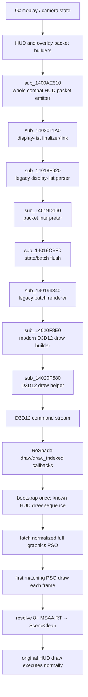

# ACZ render/HUD total path

Verified against the 2026 Windows x64 executable with SHA-256:

```text
43814d4b3292efd0a07fd71bef2f1670c0e5ac7cf2595c9e136d78451380a664
```

IDA image base: `0x140000000`.

This page explains the end-to-end semantic path. Address-level details are indexed in [`FUNCTIONS.md`](FUNCTIONS.md).

## 1. High-level path



The key architectural fact is that CPU semantic scope and ReShade draw callbacks are separated in time.

The renderer parses/queues legacy commands first. ReShade observes actual D3D12 draws later. Therefore a CPU thread-local "inside HUD parser" flag is not a valid production discriminator for draw callbacks.

## 2. Whole combat-HUD packet seam

Per-frame call site:

```asm
0x140108976  call sub_1400AE510
0x14010897B  mov  rdx, rax
0x140108981  call sub_1402011A0
```

**Verified semantic interpretation:**

- `sub_1400AE510` emits the complete combat-HUD logical packet range.
- Its return value is the end/result pointer.
- `sub_1402011A0` finalizes/links the returned display-list region.

The CPU-side packet interval from the emitter start to its returned result was used as the original semantic oracle.

This seam is semantically stronger than inferring HUD from arbitrary GPU draw counts, but it is no longer needed in the final production add-on.

## 3. Legacy parser path

`sub_14018F920` is the outer legacy display-list parser.

Observed control tags include:

```text
0x10000006
0x50000006
0x30000004
0x50000004
0x10000007
0x50000007
```

The parser branches on `tag & 0x70000000` and forwards packet payloads to:

```text
sub_14019D160(a1, a2 + 2, 4 * low16_length + 2, v5)
```

`sub_14019D160` takes four arguments. Earlier three-argument assumptions were corrected during calibration.

The exact format is intentionally documented as a **legacy display-list/render-command format**, not claimed to be a byte-for-byte PS2 GS/GIF structure.

## 4. Packet interpreter to D3D12

`sub_14019D160` loops through packet words and dispatches using:

```cpp
opcode = HIBYTE(*word) & 0x7F;
```

Observed opcode cases include:

```text
1, 2, 3, 20, 23, 31, 32, 74, 80, 81
```

Important callees include:

```text
sub_14019CBF0
sub_14019CD40
sub_14020EA20
sub_140196530
```

Current semantic reading:

```text
sub_14019CD40  state/data unpack/copy
sub_14019CBF0  state flush / batch boundary
sub_140194840  legacy batch renderer
sub_14020F8E0  modern D3D12 draw builder
sub_14020F680  game-side D3D12 draw helper
```

`sub_140194840` calls `sub_14020F8E0` at multiple sites, including:

```text
0x140195464
0x140195B4B
```

## 5. Why CPU scope did not become the final bridge

The temporary oracle marked CPU scope around the modern draw builder.

Runtime calibration showed:

```text
ReShade draw callback scope = 0
```

even for GPU draws later proven to belong to the HUD.

This is an architectural timing fact:

```text
CPU semantic packet scope
    ↓
legacy translation / queueing
    ↓
scope ends
    ↓
actual D3D12 draw recording/events
```

The production design therefore uses the CPU seam only to bootstrap/calibrate a GPU identity.

## 6. GPU calibration result

Full-stream calibration aligned the first 63 HUD draws continuously.

Immediately before the first confirmed HUD draw, one validated gameplay sequence was:

```text
IDX64
DRAW4
IDX89   ← ReShade callback occurs before this draw executes
```

Initial partial pipeline identity:

```text
legacy stable = 0xc45ffe89e386cb09
VS            = 0x70848fc93426bb4e
PS            = 0xae6370c8685b4894
topology      = 0x5
```

A simple `[IDX64, DRAW4, IDX89]` validator produced roughly one hit per frame during the first validation window.

This proved there was a usable GPU correspondence, but not that the draw-count sequence was invariant.

## 7. Production closure: normalized full PSO

Runtime testing later showed the draw sequence changes with:

- `MISSION START` appearing/disappearing;
- subtitles/temporary overlays;
- cockpit rendering;
- third-person camera;
- ordinary gameplay state changes.

The old partial fingerprint also collided across many PSOs using the same shaders/topology.

A normalized full graphics-PSO fingerprint was therefore added. It includes:

```text
normalized pipeline layout / root signature
shader bytecode hashes
input layout
blend state
rasterizer state
depth/stencil state
primitive topology
render-target formats
depth-stencil format
sample mask/count
viewport/max-vertex declarations
dynamic-state declarations
pipeline flags
```

It explicitly does **not** hash:

```text
runtime PSO pointer
root-signature pointer
arbitrary C++ structure padding
subobject data pointers
```

The correct bootstrap PSO was observed as:

```text
full_pso    = 0x3ef04bb2bb111cce
layout_hash = 0x904e7af1a7dbb185
```

The decisive runtime observation was that miss frames still contained this same `full_pso`, but the first draw count changed, e.g. from `IDX89` to `IDX94`.

That proved draw count was incidental while the normalized PSO remained the useful identity.

## 8. Current production frame path

```mermaid
sequenceDiagram
    participant G as ACZ
    participant R as ReShade callbacks
    participant B as ACZRenderBridge
    participant F as ReShade FX

    G->>R: draw stream begins
    R->>B: draw/draw_indexed events
    B->>B: if not bootstrapped, detect known legacy anchor
    B->>B: latch current full_pso
    Note over B: one-time bootstrap only
    R->>B: later frame: first draw where full_pso == latched full_pso
    B->>B: resolve current MSAA RTV to SceneClean
    R-->>G: return false; original HUD draw executes normally
    G->>R: rest of HUD + frame
    R->>F: reshade_begin_effects
    B->>F: ACZ_SCENE_CLEAN semantic + freshness
```

This is the current stable boundary between reverse engineering and post-processing work.
