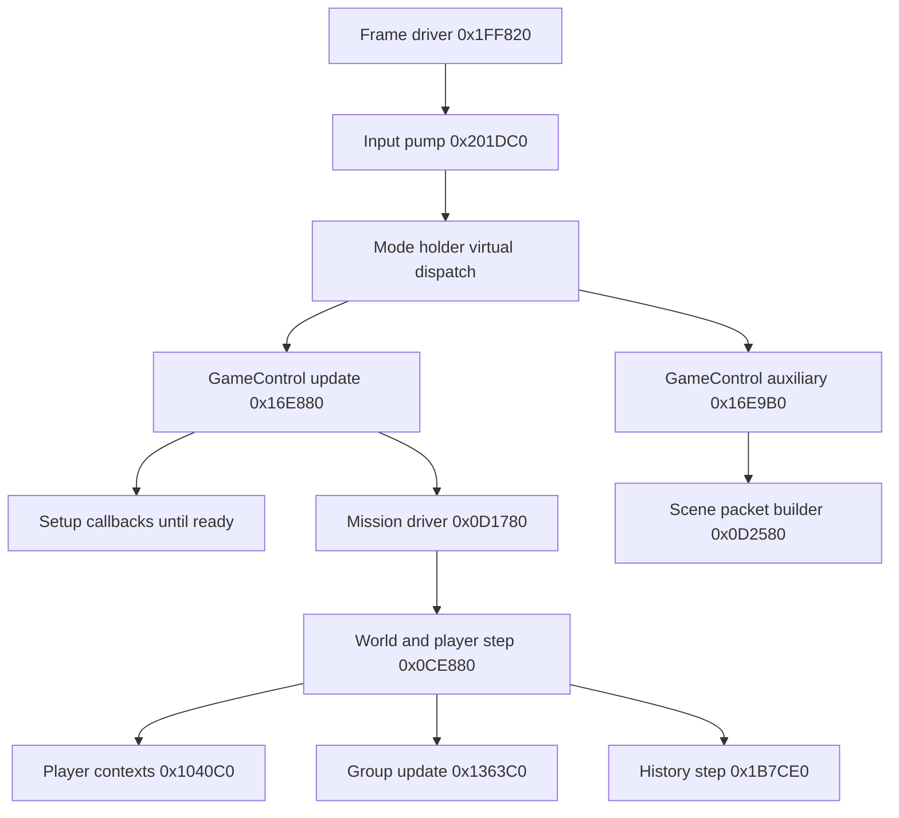

# Simulation and synchronization boundaries

Build/confidence: [README](README.md). Address details are reproducible in
`evidence/decompiled/<VA>.asm`, `.c` and `.json`.

## 1. Recovered ordering



Edges show recovered calls/dispatch roles, not measured timing. In the normal
world step, `0x1040C0` loops over player contexts, then `0x1363C0` dispatches group
updates; the history path runs after the relevant gameplay work. Special pause,
movie/replay and mission branches may bypass or change these paths. The upper
mode dispatch is virtual and is not fully represented by direct-call indexes.

`W+0xA878C` is incremented on an active-world branch. It is a useful tick candidate,
not a verified wall-clock or universal simulation serial. The frame-level counter
at the configuration object `+0x10` also advances outside normal combat. The patch
needs its own accepted simulation tick and separate lifecycle epoch.

The renderer's `Present(1,0)` and ReShade present serial are not simulation clocks.
Neither GPU draw callbacks nor UI rendering callbacks are safe places to mutate
authoritative aircraft state.

## 2. Group/entity update

`0x1363C0(manager, arg)` checks manager flags, iterates the groups, stamps a byte
of the manager counter into every actor `+0x21C`, and invokes group vfunc `+0x10`.
One flag path updates only the first group. A periodic path calls `0x1338C0`.

RTTI maps `Unit::vtable +0x10` to `0x132240`; specialized groups can override it.
`0x1338C0` evaluates relationships/proximity and can itself call `0x118040`.
Disabling this dispatcher would suppress more than enemy aircraft movement.
Client-side authority gates must account for its damage/AI side effects.

Initial group storage is data-driven:

1. `0x135B50` estimates required storage from definitions.
2. `0x12C410` includes `definition.actor_count * 0x520` and per-actor resources.
3. `0x135CB0` constructs the group pointer table, selects specialized vtables and
   dispatches each constructor through its vtable.
4. `0x0CBCC0` connects the resulting actors to resources and player contexts.

These are **initial construction seams**, not a recovered safe runtime-spawn API.
`0x135CB0` also fixes relationships between actors (`+0x3A8/+0x3B0`); shallow
copying a group would duplicate ownership and stale internal links.

## 3. Existing history/event path

| RVA | Static role |
| --- | --- |
| `0x019EF0` | Returns the singleton at RVA `0x31E980`, with lazy initialization. |
| `0x019F80` | Resets linked lists/free pools and counters. |
| `0x01A0C0` | Ages/recycles records; includes a time comparison against `current - 0x438`. |
| `0x01A2A0` | Chooses records to capture from actor flags, IDs and state changes. |
| `0x01AAC0`, `0x01ADC0`, `0x01B010` | Encode specific event/state record classes into the pools. |
| `0x1B6480/0x1B8130` | Prepare a bounded playback window and reset selected world/player state. |
| `0x1B7480/0x1B9400` | Apply/interpolate recorded state and replay selected weapon/death/effect events. |
| `0x01DDC0/0x01DF10` | Decode and interpolate recorded pose-like fields. |
| `0x1B7CE0` | Traverses actors, copies current vectors to previous vectors, captures selected records and advances the history counter. |

The previous vectors at actor `+0x288/+0x298` are copied from `+0x258/+0x268`.
Record sizes include `0x70`, linked-list pointers, selectors and time fields.
`0x01A2A0` uses different decimation decisions by actor type/distance and checks
record capacity. It may reduce detail when storage is constrained.

The reader path is recovered as well: `0D1780 → 1B7480 → 1B9400`. It writes
recorded pose/flags/player fields and invokes native weapon launch and damage
paths. Preparation sets actor HP to `0xFF`; weapon records include native resource
pointers. See [the focused reader analysis](PLAYBACK_AND_WEAPONS.md).

**Implication:** this is a valuable source for event taxonomy and interpolation
research. It is not a proven exact checkpoint of input history, RNG, mission VM,
allocator state, projectile ownership, side effects, and every actor. A claim of
rollback capability requires an actual restore-and-resimulate equality test.
The `0x438` comparison must not be converted into seconds before the clock rate
has been measured.

## 4. RNG and determinism

`0x242630` performs:

```cpp
// Storage observed at per-thread CRT context +0x28, obtained via 0x25244C.
state = state * 0x343FDu + 0x269EC3u;  // modulo 2^32
return (state >> 16) & 0x7FFF;
```

`0x24265C` writes the seed to the same context field. This is a CRT-style
per-thread state, not a plain global at a fixed module RVA. The initial index
contained **271 direct rand call sites in 101 callers** and **15 direct seed
call sites**. Recalculate these values from the archived index when changing
analysis settings; indirect calls and uninferred code can add more.

Callers include `0x1040C0` (player processing), `0x118040` (damage decisions),
`0x132240`-related gameplay paths, AI/view helpers and effect-generation code.
Setup code also seeds this generator. Identical mission IDs and inputs therefore
do not establish equal random consumption or equal simulation states.

**D: architectural decision:** start with a host-authoritative world and ordered
reliable gameplay events. Treat deterministic lockstep as an alternative only
after reproducible traces demonstrate equality across both players' view modes,
machines, pause sequences, weapons and mission scripts. Do not seed the entire
CRT repeatedly per frame; other game/port consumers may share that state.

## 5. Transport audit

The PE imports 255 symbols/ordinals from 17 DLLs. Steam imports include context
initialization and callbacks. The defined-string reference index directly ties
`SteamInput006`, `SteamUser023` and `SteamUtils010` to wrapper functions.

The following four strings have no direct references in the initial
defined-string-start index and no exact-address entries in its data-reference
index:

| VA | String |
| --- | --- |
| `0x1402CF09E` | `SteamNetworkingUtils004` |
| `0x1402CF1F7` | `SteamNetworkingMessages002` |
| `0x1402CF212` | `SteamNetworkingSockets012` |
| `0x1402CF22C` | `SteamNetworking006` |

This is a **negative bounded search**, not proof that no indirect/offcut/runtime
network path can exist. No peer/session state, gameplay packet schema, send/receive
loop, network tick or co-op replication handler was recovered in the inspected
closure. The patch plan consequently creates its own transport/replication layer.

`Player1=%llx` / `Player2=%llx` occur in the port's configuration I/O. Their values
must be classified by controller/launcher data flow; they are not demonstrated
remote peer identifiers.

## 6. What must be synchronized (D)

| Domain | Authority / ownership | Required contract |
| --- | --- | --- |
| Pilot inputs | Each peer owns its own input; host assigns accepted tick | Sequence, edges, stale-input timeout, slot ownership |
| Player flight state | Host final authority; guest may predict local flight | Position/rotation/velocity and all integrator dependencies |
| AI and ordinary units | Host | Stable spawn identity, state, target, despawn |
| Missiles/guns/special weapons | Host validates; visual prediction is optional | Source/target IDs, weapon kind, spawn, ammo, hits, expiry |
| Damage/kills/score | Host | Idempotent event ID, actual HP result, killer attribution |
| Mission scripting | Host | Objective/phase progression, event ordering and side effects |
| Briefing/movie/transition | Host barrier plus peer readiness | Same mission epoch and content selection; no divergent continuation |
| Cameras/HUD/audio | Local | Follow local pilot; avoid feeding view-only mutations into authority |
| Campaign persistence | Host campaign save by default | Guest progression policy, result agreement, rollback on failure |

No existing data structure is accepted as a complete wire schema. Packet layouts,
tick/snapshot rates and interpolation settings in the implementation book are
design starting points with explicit acceptance tests.
